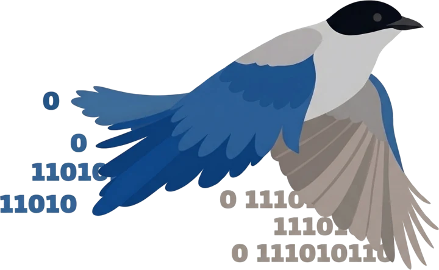
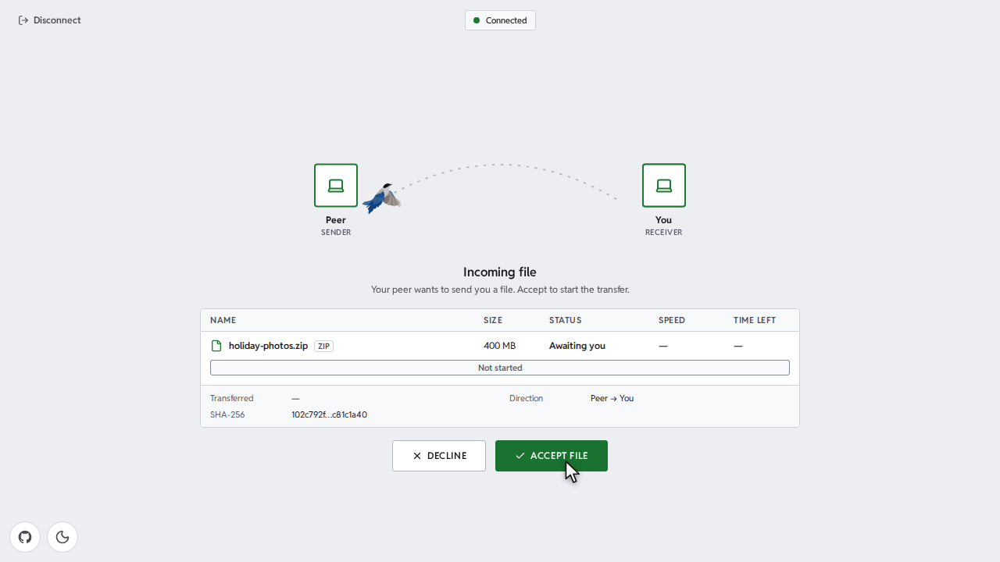
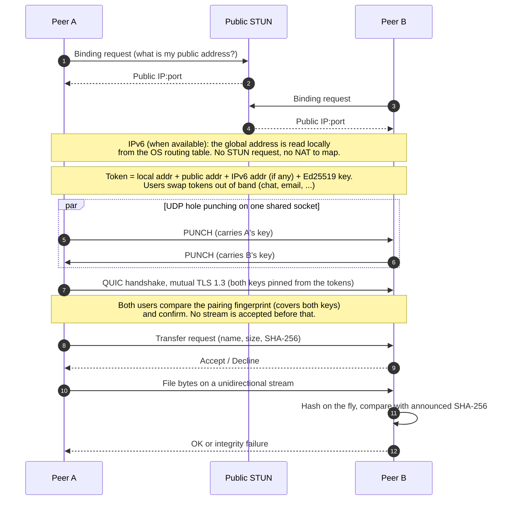
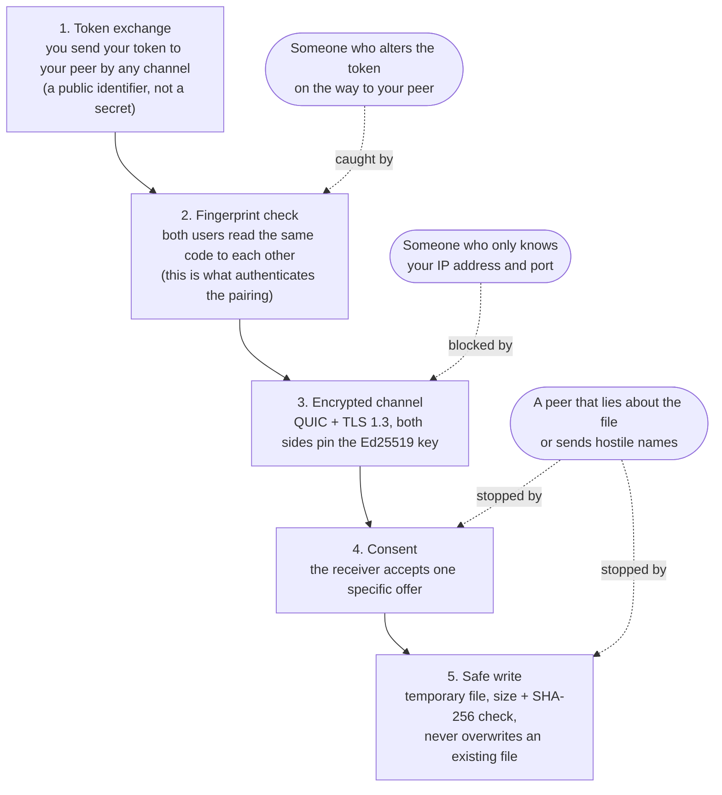
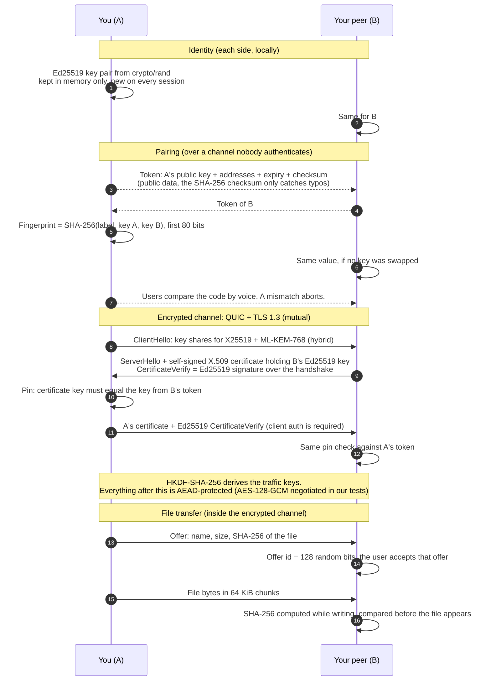

<div align="center">



# File Throw

**Send files of any size straight to another computer. No server in the middle: no upload, no account, no size limit.**

<br>

[](https://github.com/bernardo125/File-Transfer-Utility/actions/workflows/test.yml)
[](go.mod)
[](LICENSE)
[](#how-it-works)
[](#security-model)
[](#getting-started)
[-1f8434)](docs/TESTING.md)

[Download](#download) ·
[Why](#why-file-throw) ·
[Demo](#demo) ·
[How it works](#how-it-works) ·
[Security](#security-model) ·
[Getting started](#getting-started) ·
[Limitations](#network-compatibility-and-limitations) ·
[Engineering](#engineering-quality)

<br>


</div>

---

## Download

Direct links to the latest release (a single file per platform, no installer):

| Platform | Download | Notes |
|---|---|---|
| **Windows** (64-bit) | [`ftu-windows-amd64.exe`](https://github.com/bernardo125/File-Transfer-Utility/releases/latest/download/ftu-windows-amd64.exe) | Windows 10/11 (needs the WebView2 runtime, already present on current Windows). |
| **macOS** (Apple silicon and Intel) | [`ftu-macos-universal.zip`](https://github.com/bernardo125/File-Transfer-Utility/releases/latest/download/ftu-macos-universal.zip) | Unzip and move `ftu.app` to Applications. |
| **Linux** (x86-64) | [`ftu-linux-amd64`](https://github.com/bernardo125/File-Transfer-Utility/releases/latest/download/ftu-linux-amd64) | Needs `libwebkit2gtk-4.1` and GTK 3. Run `chmod +x ftu-linux-amd64` first. |

All files, checksums and release notes: [Releases](https://github.com/bernardo125/File-Transfer-Utility/releases).

**Verify the download** (recommended): compare the file's SHA-256 with `SHA256SUMS.txt` from the same release, e.g. `sha256sum ftu-linux-amd64` (Linux), `shasum -a 256 ftu-macos-universal.zip` (macOS) or `certutil -hashfile ftu-windows-amd64.exe SHA256` (Windows).

**First run.** The builds are **not code-signed yet**, so the operating system warns about an unknown publisher:

- *Windows SmartScreen:* click **More info**, then **Run anyway**.
- *macOS Gatekeeper:* right-click `ftu.app`, choose **Open**, then **Open** again (or allow it in *System Settings → Privacy & Security*).

Prefer to build it yourself? See [Getting started](#getting-started).

## Why File Throw

Chat apps cap attachment sizes. Cloud transfer services make you upload first and wait for the recipient to download, through a server that stores your data. Most "peer-to-peer" tools still depend on a **signaling or relay server** to introduce the two machines.

File Throw removes that middle layer:

- **No signaling server.** The two users exchange a short text token through any channel they already use (chat, email, a note). That token carries everything needed to find and authenticate the other side.
- **No relay and no upload.** Data flows directly between the two machines over QUIC, so the speed is limited by the network and the disks, not by a server.
- **Bounded memory.** Files are streamed in chunks and hashed on the fly: a 96 MiB transfer grew the heap by only about 4 MiB in our tests, so multi-gigabyte files do not need multi-gigabyte RAM.
- **Verified end to end.** The receiver checks the SHA-256 of what actually arrived, and a corrupted or truncated file is deleted, never reported as success.

The only external service is a **public STUN server**, used solely to learn your own public address (a single request-response). It never sees your files, your token or your peer.

## Demo

| 1. Choose a role | 2. Swap tokens |
|:--:|:--:|
|  |  |
| **3. Offer a file** | **4. Stream directly** |
|  |  |

> These images are generated from the real app (two real backends talking over QUIC) by `npm run docs:media` in [`tests/ui`](tests/ui), so they never drift from the UI.

### How to use it

1. **Both users** open File Throw. One picks **Send**, the other **Receive**.
2. Each side shows a **token**. Send yours to the other person through any channel, and paste theirs into the *Peer token* box.
3. Both press **Connect**. The apps punch through their routers and open an encrypted QUIC session (a few seconds; you see each stage live).
4. Both screens show the same **pairing fingerprint** (five groups of four characters). **Read it to each other** by voice or on another channel and press *They match* only if it is identical. Nothing can be sent or received until both of you have confirmed it.
5. The sender picks a file. The receiver sees its **name and size** and chooses **Accept** or **Decline**.
6. The file streams with live speed and ETA. At the end the receiver shows **verified** only if the SHA-256 matches. It is saved under a new name (`report (1).pdf`) if a file with that name already exists; existing files are never overwritten. Several files can be sent in the same session.

## How it works



| Stage | What happens | Code |
|---|---|---|
| **Discovery** | One UDP socket asks a STUN server for its public IPv4 address and port. If the machine has IPv6, its global address is read locally from the OS (no packet is sent). The same socket is reused for everything that follows, which is what keeps the NAT mapping alive. | [`internal/discovery`](internal/discovery) |
| **Token** | `ftu2.` + base64url of: magic, version, flags, the peer's Ed25519 public key, local and public IPv4 (plus IPv6 when available), an expiry time (24 h) and a 4-byte checksum (56 or 74 bytes). A public identifier, not a secret. Older `v1` tokens are still accepted. | [`signalingToken.go`](internal/discovery/signalingToken.go) |
| **Hole punching** | Both sides send small `PUNCH` packets at all of the other's candidates in parallel (LAN, public IPv4, IPv6). The first packet carrying the expected key **from one of the token's addresses** wins, so a same-LAN peer connects without leaving the network; if that address does not answer, the other addresses from the token are tried. | [`internal/connectivity`](internal/connectivity) |
| **Secure channel** | QUIC over the punched socket. The roles (dialer or listener) are decided by comparing the two public keys, so no coordination is needed. Both certificates must hold exactly the key from the token (checked on every handshake, including resumed ones). | [`internal/transport`](internal/transport) |
| **Protocol** | A tiny HTTP-style exchange on a control stream (`uint32` length + JSON, capped at 64 KiB, status codes such as 100/200/403/409), then the payload on its own stream. | [`internal/protocol`](internal/protocol) |
| **Transfer** | 64 KiB chunks written to disk while hashed; size is enforced; failures remove the partial file. | [`internal/transfer`](internal/transfer) |

**Why IPv6 matters.** IPv6 addresses are globally routable, so there is no NAT mapping to guess and no STUN round trip. The token simply carries the peer's IPv6 address and port as one more candidate, tried in parallel with the IPv4 ones. Home routers still run a stateful firewall that drops unsolicited inbound packets, and the hole-punch does exactly what is needed there: each side sends first, which opens the pinhole for the other. With IPv6 on both ends the connection can therefore be direct even where IPv4 would sit behind a symmetric NAT or CGNAT. If only one side has IPv6, the apps fall back to the IPv4 candidates. (The automated tests run over IPv4 loopback, so the IPv6 path is implemented but not exercised by them.)

Design notes (in Portuguese) with the reasoning behind each choice are in [`docs/notebook.md`](docs/notebook.md).

## Security model

### Security architecture at a glance

Every transfer goes through five checks, in this order. Each one stops a different kind of attacker:



**Cryptography step by step**



**The cryptographic building blocks**

| Primitive | Implementation | Used for | Notes |
|---|---|---|---|
| **Ed25519** | Go `crypto/ed25519` | Your session identity: signs the TLS handshake; its public half is what your peer pins | Key from `crypto/rand`, memory only, never persisted |
| **X25519 + ML-KEM-768** (hybrid) | Go `crypto/tls` defaults, through quic-go | Key exchange of every connection (forward secrecy) | Negotiated by two builds of this app in our test. The ML-KEM part is post-quantum; it depends on both peers' Go versions, otherwise X25519 alone is used |
| **TLS 1.3** | Go `crypto/tls`, TLS 1.3 enforced | Mutual authentication, key schedule (HKDF-SHA-256) | No downgrade to older versions |
| **QUIC packet protection** | quic-go (RFC 9001) | Encrypts and authenticates every packet and its header | AEAD: AES-128-GCM was negotiated in our tests (AES-256-GCM or ChaCha20-Poly1305 are also possible) |
| **X.509, self-signed** | Go `crypto/x509` | A container for the Ed25519 key | No CA: trust comes from the pinned key, not from the certificate |
| **SHA-256** (file) | Go `crypto/sha256` | Integrity of each file, computed while receiving | Proves the bytes arrived intact, not who produced them |
| **SHA-256** (fingerprint) | Go `crypto/sha256` | The code both users compare | 80 bits of a hash over *both* public keys |
| **SHA-256** (token checksum) | Go `crypto/sha256` | Detects a mistyped or truncated token | 32 bits, not a security control: anyone can recompute it |
| **Random numbers** | Go `crypto/rand` | Key pairs, offer ids, STUN transaction ids | 128 bits for offers, 96 bits for STUN |
| **ChaCha20** (legacy) | `golang.org/x/crypto` | Only to read old `v1` tokens | A constant key shipped in the binary: obfuscation, not secrecy. New tokens do not use it |

No cryptographic primitive is implemented in this project: everything comes from Go's standard library, `golang.org/x/crypto` (legacy token only) and quic-go. Authentication is classical (Ed25519), so a future quantum computer could forge a *new* handshake, but traffic recorded today stays protected by the hybrid key exchange.

**Where the trust comes from.** There is no server or certificate authority, so trust starts with *you and your peer*: the token carries the key, and the fingerprint comparison confirms nobody changed it. After that, the cryptography keeps the session private and tied to those two keys.

**What it does not protect against.** A peer you chose to trust can still send you a bad file (you must accept each one, and the name and size are shown). If you confirm the fingerprint without really comparing it, an attacker on the token channel could sit in the middle. Files you receive are not yet marked by the OS as "downloaded from the internet", and the builds are not code-signed yet.

Full audit, threat model and per-finding status: [`docs/security`](docs/security) (including a detailed [PlantUML diagram](docs/security/SECURITY_ARCHITECTURE.puml)).

### Details

| Property | How it is achieved |
|---|---|
| Confidentiality and integrity in transit | QUIC with TLS 1.3. |
| Peer authentication, with no CA and no server | **Mutual** TLS where each side must present the Ed25519 key that was in the token it was given. A host that only knows the peer's address cannot join the session. |
| File integrity | SHA-256 computed while receiving, compared with the hash announced in the request. The data goes to a private temporary file that only becomes the final file after size and hash are verified; a mismatch removes the temporary file and never touches a file you already had. The hash proves the bytes arrived intact, not who produced them. |
| Hostile input | Control frames are bounded, metadata is validated (size, hash format, file name), file names are reduced to one safe component (no paths, no dotfiles, no Windows device names or stream separators, no control or bidi characters), STUN replies must answer our own request, and the token and STUN parsers return errors instead of crashing. They are fuzzed. |
| Consent | The receiver sees name and size and must accept. A decision is bound to one specific offer (random id); a second offer is refused while one is pending, and stale or duplicate answers are rejected. |
| Pairing | The token travels over a channel nobody authenticates, so both users must confirm the same fingerprint of both public keys before any data channel is used. The backend enforces this. |
| Renderer trust | The UI can only send files picked in the native file dialog and can only open folders inside the download directory; the production bundle ships a Content-Security-Policy. |

**What the token is, honestly:** a public identifier. It contains your addresses and your session's Ed25519 public key; it is not secret and its checksum only catches typos (anyone can recompute it). Its job is to **pin the identity** (the Ed25519 key), and the QUIC handshake enforces that. Because a token can be swapped by someone who controls the channel you send it through, the **fingerprint comparison is what authenticates the pairing**: if the two screens show different fingerprints, press *They don't match*. Tokens expire after 24 h; a new key pair is generated each time the app starts.

Security audit, threat model and remediation status: [`docs/security`](docs/security).

## Network compatibility and limitations

File Throw is deliberately **TURN-free**: relays that are free have tiny bandwidth caps, which would defeat the purpose, and a paid relay would reintroduce the server this project exists to avoid.

| Scenario | Works? |
|---|:--:|
| Same LAN | Yes (the local candidate answers first) |
| Different networks behind home routers (full-cone / restricted NAT) | Yes, via STUN + hole punching |
| Public IPv6 on both ends | Yes (advertised as an extra candidate) |
| Symmetric NAT or carrier-grade NAT on either side | **No.** The mapping differs per destination, so the punch cannot succeed. Roughly 15-20% of internet users are in this situation. |
| Resume after a dropped connection | Not supported: start a new session |

Other known limit: one file at a time per session.

## Getting started

**Prerequisites:** Go 1.26+, Node 22+, and the [Wails v2 CLI](https://wails.io/docs/gettingstarted/installation) (on Linux it needs the GTK3 and WebKitGTK development packages; on Windows, WebView2).

```bash
git clone https://github.com/bernardo125/File-Transfer-Utility.git
cd File-Transfer-Utility

# Desktop app (builds the frontend and the binary into build/bin)
wails build

# Live-reload development
wails dev

# Terminal-only mode, no GUI
go run ./cmd/ftu -cli
```

## Engineering quality

The test suite exercises the real stack (real UDP sockets, real QUIC, real hole punching), not mocks, and was validated by deliberately breaking the code to confirm the tests notice.

| Layer | Tests | What it proves | Run |
|---|:--:|---|---|
| Unit | 71 | framing, validation, token and STUN parsing, hashing, the UI's transfer state machine | `make test-fast`, `make test-frontend` |
| Integration | 38 | mutual authentication, hole punch, transfer integrity at chunk boundaries, peers dying mid-transfer, the UI backend with two real instances | `make test`, `make race` |
| End to end | 12 | the whole pipeline in Go (including lossy, reordering and duplicating networks) and the real UI in a browser, with files checked by SHA-256 on the receiver's disk | `make test-ui` |
| Fuzzing | 4 | control frames, requests, tokens, STUN responses | `make fuzz` |
| Benchmarks | 4 | framing, hashing, QUIC throughput | `make bench` |

Details, environment notes and the list of what is *not* covered are in [`docs/TESTING.md`](docs/TESTING.md). The UI is also checked with axe for WCAG 2.1 A/AA, with the traceability matrix in [`docs/accessibility-traceability-matrix.md`](docs/accessibility-traceability-matrix.md).

## Project structure

```
.
├── cmd/ftu/              CLI / entry point
├── internal/
│   ├── discovery/        STUN client, token encode/decode
│   ├── connectivity/     UDP hole punching
│   ├── transport/        QUIC upgrade, mutual TLS with pinned Ed25519 keys
│   ├── protocol/         control-stream framing, request/response, sender and receiver
│   ├── transfer/         chunked streaming, on-the-fly SHA-256
│   └── testutil/         real-socket helpers, seeded UDP impairment proxy
├── pkg/
│   ├── cli/              terminal interface
│   └── ui/               Wails backend (App) bound to the frontend
├── frontend/             React 19 + Vite + Tailwind UI
├── tests/ui/             Playwright suite (real UI + real backends) and docs media generator
├── docs/                 design notebook, testing guide, accessibility matrix, media
└── assets/               logo
```

## License

Released under the [MIT License](LICENSE).

## Author

**Bernardo Santos**, [@bernardo125](https://github.com/bernardo125)
