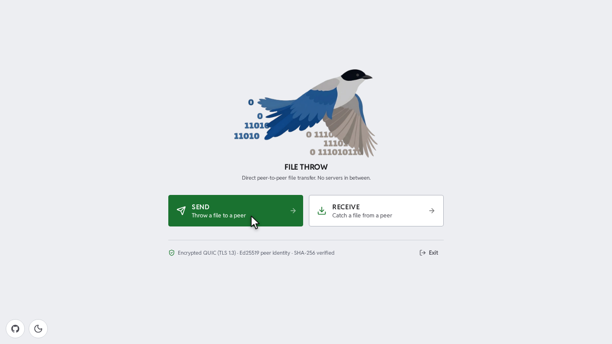
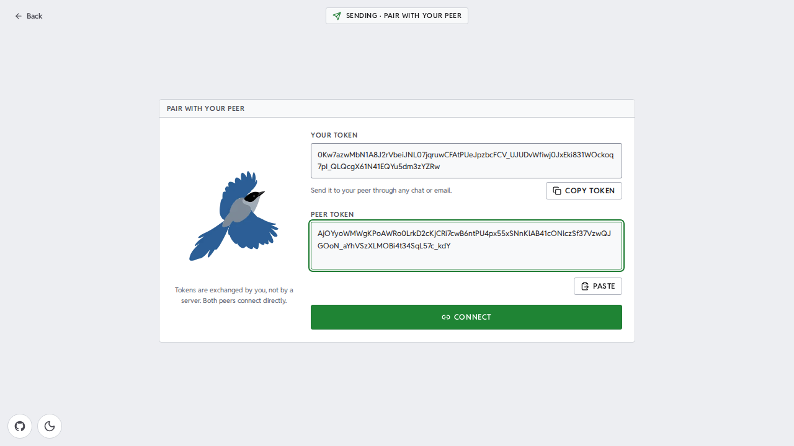
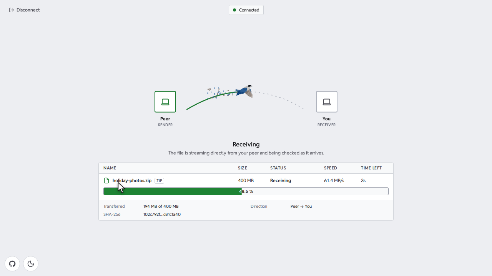
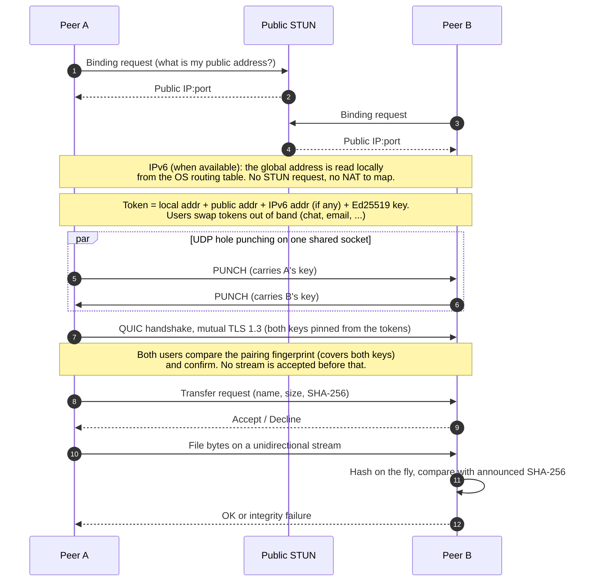

<div align="center">


# File Throw

**Send files of any size straight to another computer. No server in the middle: no upload, no account, no size limit.**

<br>

[](https://github.com/bernardo125/File-Transfer-Utility/actions/workflows/test.yml)
[](go.mod)
[](LICENSE)
[](#how-it-works)
[](#security-model)
[](#getting-started)
[-1f8434)](docs/TESTING.md)

[Download](#download) ·
[Why](#why-file-throw) ·
[Demo](#demo) ·
[How it works](#how-it-works) ·
[Security](#security-model) ·
[Getting started](#getting-started) ·
[Limitations](#network-compatibility-and-limitations) ·
[Engineering](#engineering-quality)

<br>


</div>

---

## Download

Direct links to the latest release (a single file per platform, no installer):

| Platform | Download | Notes |
|---|---|---|
| **Windows** (64-bit) | [`ftu-windows-amd64.exe`](https://github.com/bernardo125/File-Transfer-Utility/releases/latest/download/ftu-windows-amd64.exe) | Windows 10/11 (needs the WebView2 runtime, already present on current Windows). |
| **macOS** (Apple silicon and Intel) | [`ftu-macos-universal.zip`](https://github.com/bernardo125/File-Transfer-Utility/releases/latest/download/ftu-macos-universal.zip) | Unzip and move `ftu.app` to Applications. |
| **Linux** (x86-64) | [`ftu-linux-amd64`](https://github.com/bernardo125/File-Transfer-Utility/releases/latest/download/ftu-linux-amd64) | Needs `libwebkit2gtk-4.1` and GTK 3. Run `chmod +x ftu-linux-amd64` first. |

All files, checksums and release notes: [Releases](https://github.com/bernardo125/File-Transfer-Utility/releases).

**Verify the download** (recommended): compare the file's SHA-256 with `SHA256SUMS.txt` from the same release, e.g. `sha256sum ftu-linux-amd64` (Linux), `shasum -a 256 ftu-macos-universal.zip` (macOS) or `certutil -hashfile ftu-windows-amd64.exe SHA256` (Windows).

**First run.** The builds are **not code-signed yet**, so the operating system warns about an unknown publisher:

- *Windows SmartScreen:* click **More info**, then **Run anyway**.
- *macOS Gatekeeper:* right-click `ftu.app`, choose **Open**, then **Open** again (or allow it in *System Settings → Privacy & Security*).

Prefer to build it yourself? See [Getting started](#getting-started).

## Why File Throw

Chat apps cap attachment sizes. Cloud transfer services make you upload first and wait for the recipient to download, through a server that stores your data. Most "peer-to-peer" tools still depend on a **signaling or relay server** to introduce the two machines.

File Throw removes that middle layer:

- **No signaling server.** The two users exchange a short text token through any channel they already use (chat, email, a note). That token carries everything needed to find and authenticate the other side.
- **No relay and no upload.** Data flows directly between the two machines over QUIC, so the speed is limited by the network and the disks, not by a server.
- **Bounded memory.** Files are streamed in chunks and hashed on the fly: a 96 MiB transfer grew the heap by only about 4 MiB in our tests, so multi-gigabyte files do not need multi-gigabyte RAM.
- **Verified end to end.** The receiver checks the SHA-256 of what actually arrived, and a corrupted or truncated file is deleted, never reported as success.

The only external service is a **public STUN server**, used solely to learn your own public address (a single request-response). It never sees your files, your token or your peer.

## Demo

| 1. Choose a role | 2. Swap tokens |
|:--:|:--:|
|  |  |
| **3. Offer a file** | **4. Stream directly** |
|  |  |

> These images are generated from the real app (two real backends talking over QUIC) by `npm run docs:media` in [`tests/ui`](tests/ui), so they never drift from the UI.

### How to use it

1. **Both users** open File Throw. One picks **Send**, the other **Receive**.
2. Each side shows a **token**. Send yours to the other person through any channel, and paste theirs into the *Peer token* box.
3. Both press **Connect**. The apps punch through their routers and open an encrypted QUIC session (a few seconds; you see each stage live).
4. Both screens show the same **pairing fingerprint** (five groups of four characters). **Read it to each other** by voice or on another channel and press *They match* only if it is identical. Nothing can be sent or received until both of you have confirmed it.
5. The sender picks a file. The receiver sees its **name and size** and chooses **Accept** or **Decline**.
6. The file streams with live speed and ETA. At the end the receiver shows **verified** only if the SHA-256 matches. It is saved under a new name (`report (1).pdf`) if a file with that name already exists; existing files are never overwritten. Several files can be sent in the same session.

## How it works



| Stage | What happens | Code |
|---|---|---|
| **Discovery** | One UDP socket asks a STUN server for its public IPv4 address and port. If the machine has IPv6, its global address is read locally from the OS (no packet is sent). The same socket is reused for everything that follows, which is what keeps the NAT mapping alive. | [`internal/discovery`](internal/discovery) |
| **Token** | `ftu2.` + base64url of: magic, version, flags, the peer's Ed25519 public key, local and public IPv4 (plus IPv6 when available), an expiry time (24 h) and a 4-byte checksum (56 or 74 bytes). A public identifier, not a secret. Older `v1` tokens are still accepted. | [`signalingToken.go`](internal/discovery/signalingToken.go) |
| **Hole punching** | Both sides send small `PUNCH` packets at all of the other's candidates in parallel (LAN, public IPv4, IPv6). The first packet carrying the expected key **from one of the token's addresses** wins, so a same-LAN peer connects without leaving the network; if that address does not answer, the other addresses from the token are tried. | [`internal/connectivity`](internal/connectivity) |
| **Secure channel** | QUIC over the punched socket. The roles (dialer or listener) are decided by comparing the two public keys, so no coordination is needed. Both certificates must hold exactly the key from the token (checked on every handshake, including resumed ones). | [`internal/transport`](internal/transport) |
| **Protocol** | A tiny HTTP-style exchange on a control stream (`uint32` length + JSON, capped at 64 KiB, status codes such as 100/200/403/409), then the payload on its own stream. | [`internal/protocol`](internal/protocol) |
| **Transfer** | 64 KiB chunks written to disk while hashed; size is enforced; failures remove the partial file. | [`internal/transfer`](internal/transfer) |

**Why IPv6 matters.** IPv6 addresses are globally routable, so there is no NAT mapping to guess and no STUN round trip. The token simply carries the peer's IPv6 address and port as one more candidate, tried in parallel with the IPv4 ones. Home routers still run a stateful firewall that drops unsolicited inbound packets, and the hole-punch does exactly what is needed there: each side sends first, which opens the pinhole for the other. With IPv6 on both ends the connection can therefore be direct even where IPv4 would sit behind a symmetric NAT or CGNAT. If only one side has IPv6, the apps fall back to the IPv4 candidates. (The automated tests run over IPv4 loopback, so the IPv6 path is implemented but not exercised by them.)

Design notes (in Portuguese) with the reasoning behind each choice are in [`docs/notebook.md`](docs/notebook.md).

## Security model

Short version: the connection is encrypted and tied to your peer's key, you confirm the pairing yourself, and nothing is written to disk until you accept it and its SHA-256 matches. Every transfer goes through five checks, in this order, and each one stops a different kind of attacker:


**What it uses.** Ed25519 identity keys (new for every session, memory only), TLS 1.3 over QUIC with a hybrid X25519 + ML-KEM-768 key exchange (negotiated between two builds of the app in our tests), and SHA-256 for file integrity. Nothing is implemented from scratch: it all comes from Go's standard library and quic-go. Step-by-step diagram and every primitive: [`docs/security/CRYPTOGRAPHY.md`](docs/security/CRYPTOGRAPHY.md).

**What it does not protect against.**

- If you confirm the fingerprint without really comparing it, someone who controls the channel you sent the token through could sit in the middle.
- A peer you chose to trust can still send you a file you do not want. You accept each one, and the name and size are shown.
- Received files are not yet marked by the OS as "downloaded from the internet", and the builds are not code-signed yet.
- No independent audit or penetration test has been done. Findings and their status: [`docs/security`](docs/security).

Found a vulnerability? Please report it privately, see [`SECURITY.md`](SECURITY.md).

| Property | How it is achieved |
|---|---|
| Confidentiality and integrity in transit | QUIC with TLS 1.3. |
| Peer authentication, no CA, no server | Mutual TLS: each side must present the Ed25519 key from the token it was given, and both users confirm the pairing fingerprint before any data flows. |
| File integrity | SHA-256 computed while receiving and compared with the announced hash. It proves the bytes arrived intact, not who produced them. |
| Safe writing | Private temporary file, published only after size and hash match. An existing file is never overwritten (`report (1).pdf`) and a failed transfer never touches it. |
| Hostile input | Frames are size-bounded, metadata and file names are validated (no paths, dotfiles, device names or control characters), STUN replies must answer our own request, and the parsers are fuzzed. |
| Consent | The receiver sees name and size and must accept. A decision is bound to one specific offer, and a second offer is refused while one is pending. |
| Renderer trust | The UI can only send files picked in the native dialog and open folders inside the download directory. The production bundle has a Content-Security-Policy. |

## Network compatibility and limitations

File Throw is deliberately **TURN-free**: relays that are free have tiny bandwidth caps, which would defeat the purpose, and a paid relay would reintroduce the server this project exists to avoid.

| Scenario | Works? |
|---|:--:|
| Same LAN | Yes (the local candidate answers first) |
| Different networks behind home routers (full-cone / restricted NAT) | Yes, via STUN + hole punching |
| Public IPv6 on both ends | Yes (advertised as an extra candidate) |
| Symmetric NAT or carrier-grade NAT on either side | **No.** The mapping differs per destination, so the punch cannot succeed. Roughly 15-20% of internet users are in this situation. |
| Resume after a dropped connection | Not supported: start a new session |

Other known limit: one file at a time per session.

## Getting started

**Prerequisites:** Go 1.26+, Node 22+, and the [Wails v2 CLI](https://wails.io/docs/gettingstarted/installation) (on Linux it needs the GTK3 and WebKitGTK development packages; on Windows, WebView2).

```bash
git clone https://github.com/bernardo125/File-Transfer-Utility.git
cd File-Transfer-Utility

# Desktop app (builds the frontend and the binary into build/bin)
wails build

# Live-reload development
wails dev

# Terminal-only mode, no GUI
go run ./cmd/ftu -cli
```

## Engineering quality

The test suite exercises the real stack (real UDP sockets, real QUIC, real hole punching), not mocks, and was validated by deliberately breaking the code to confirm the tests notice.

| Layer | Tests | What it proves | Run |
|---|:--:|---|---|
| Unit | 71+ | framing, validation, token and STUN parsing, hashing, the UI's transfer state machine | `make test-fast`, `make test-frontend` |
| Integration | 38+ | mutual authentication, hole punch, transfer integrity at chunk boundaries, peers dying mid-transfer, the UI backend with two real instances | `make test`, `make race` |
| End to end | 12+ | the whole pipeline in Go (including lossy, reordering and duplicating networks) and the real UI in a browser, with files checked by SHA-256 on the receiver's disk | `make test-ui` |
| Fuzzing | 7 | control frames, requests, tokens (both formats), STUN responses, file-name sanitising | `make fuzz` |
| Benchmarks | 4 | framing, hashing, QUIC throughput | `make bench` |

Details, environment notes and the list of what is *not* covered are in [`docs/TESTING.md`](docs/TESTING.md). The UI is also checked with axe for WCAG 2.1 A/AA, with the traceability matrix in [`docs/accessibility-traceability-matrix.md`](docs/accessibility-traceability-matrix.md).

## Project structure

```
.
├── cmd/ftu/              CLI / entry point
├── internal/
│   ├── discovery/        STUN client, token encode/decode
│   ├── connectivity/     UDP hole punching
│   ├── transport/        QUIC upgrade, mutual TLS with pinned Ed25519 keys
│   ├── protocol/         control-stream framing, request/response, sender and receiver
│   ├── transfer/         chunked streaming, on-the-fly SHA-256
│   └── testutil/         real-socket helpers, seeded UDP impairment proxy
├── pkg/
│   ├── cli/              terminal interface
│   └── ui/               Wails backend (App) bound to the frontend
├── frontend/             React 19 + Vite + Tailwind UI
├── tests/ui/             Playwright suite (real UI + real backends) and docs media generator
├── docs/                 design notebook, testing guide, accessibility matrix, media
│   └── security/         audit, threat model, cryptography reference, remediation status
├── assets/               logo
└── SECURITY.md           how to report a vulnerability, scope, supported versions
```

## License

Released under the [MIT License](LICENSE).

## Author

**Bernardo Santos**, [@bernardo125](https://github.com/bernardo125)
