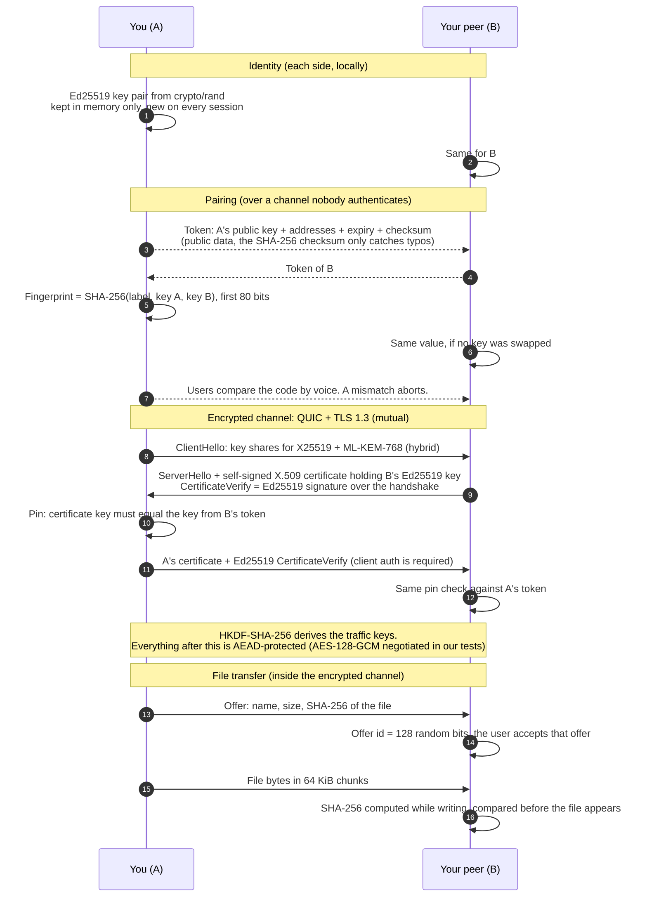

# Cryptography and key handling

Reference for how File Throw uses cryptography. The README has the short version; the audit,
threat model and per-finding status are in [`SECURITY_AUDIT.md`](SECURITY_AUDIT.md),
[`THREAT_MODEL.md`](THREAT_MODEL.md) and [`REMEDIATION_PLAN.md`](REMEDIATION_PLAN.md); a PlantUML
version of the architecture is in [`SECURITY_ARCHITECTURE.puml`](SECURITY_ARCHITECTURE.puml).

Facts below were checked against the source and, for the negotiated algorithms, against two builds
of the app talking to each other on Linux (Go 1.26). Behaviour on other platforms or Go versions
may differ where noted.

> The diagram draws A as the side that starts the handshake. In the real app the dialer/listener
> roles are decided by comparing the two public keys; the cryptography is the same in both directions.

**Cryptography step by step**

**The cryptographic building blocks**

| Primitive | Implementation | Used for | Notes |
|---|---|---|---|
| **Ed25519** | Go `crypto/ed25519` | Your session identity: signs the TLS handshake; its public half is what your peer pins | Key from `crypto/rand`, memory only, never persisted |
| **X25519 + ML-KEM-768** (hybrid) | Go `crypto/tls` defaults, through quic-go | Key exchange of every connection (forward secrecy) | Negotiated by two builds of this app in our test. The ML-KEM part is post-quantum; it depends on both peers' Go versions, otherwise X25519 alone is used |
| **TLS 1.3** | Go `crypto/tls`, TLS 1.3 enforced | Mutual authentication, key schedule (HKDF-SHA-256) | No downgrade to older versions |
| **QUIC packet protection** | quic-go (RFC 9001) | Encrypts and authenticates every packet and its header | AEAD: AES-128-GCM was negotiated in our tests (AES-256-GCM or ChaCha20-Poly1305 are also possible) |
| **X.509, self-signed** | Go `crypto/x509` | A container for the Ed25519 key | No CA: trust comes from the pinned key, not from the certificate |
| **SHA-256** (file) | Go `crypto/sha256` | Integrity of each file, computed while receiving | Proves the bytes arrived intact, not who produced them |
| **SHA-256** (fingerprint) | Go `crypto/sha256` | The code both users compare | 80 bits of a hash over *both* public keys |
| **SHA-256** (token checksum) | Go `crypto/sha256` | Detects a mistyped or truncated token | 32 bits, not a security control: anyone can recompute it |
| **Random numbers** | Go `crypto/rand` | Key pairs, offer ids, STUN transaction ids | 128 bits for offers, 96 bits for STUN |
| **ChaCha20** (legacy) | `golang.org/x/crypto` | Only to read old `v1` tokens | A constant key shipped in the binary: obfuscation, not secrecy. New tokens do not use it |

No cryptographic primitive is implemented in this project: everything comes from Go's standard library, `golang.org/x/crypto` (legacy token only) and quic-go. Authentication is classical (Ed25519), so a future quantum computer could forge a *new* handshake, but traffic recorded today stays protected by the hybrid key exchange.

## Where the trust comes from

There is no server or certificate authority, so trust starts with *you and your peer*: the token
carries the key, and the fingerprint comparison confirms nobody changed it on the way. After that
the cryptography keeps the session private and tied to those two keys. A token is a public
identifier (its checksum only catches typos); the pairing is authenticated by the users comparing
the fingerprint.

## Key lifetimes

| What | Lives where | For how long |
|---|---|---|
| Ed25519 identity key | Memory only, never written to disk | One session (new key at every start or disconnect) |
| Token | Shared by the user, in clear | Valid for 24 h |
| Pairing fingerprint | Computed on both sides | One pairing |
| TLS 1.3 session keys | Derived by QUIC | One connection |

## Known limits

- Authentication is classical (Ed25519). The hybrid key exchange protects recorded traffic against a
  future quantum computer, but a quantum attacker could forge a *new* handshake.
- The ML-KEM part of the key exchange comes from Go's defaults and depends on both peers' Go
  versions; otherwise X25519 alone is used.
- The pairing is only as strong as the users' fingerprint comparison. A PAKE short code (as in
  Magic Wormhole) would authenticate automatically; it is not implemented.
- The session key is new each time, so a peer confirmed yesterday must be confirmed again today.
- The ALPN identifier is still the sample value `quic-echo-example`, and `PUNCH` packets are not
  authenticated (mitigated by the token address filter and mTLS).
- No independent audit or penetration test has been done.
